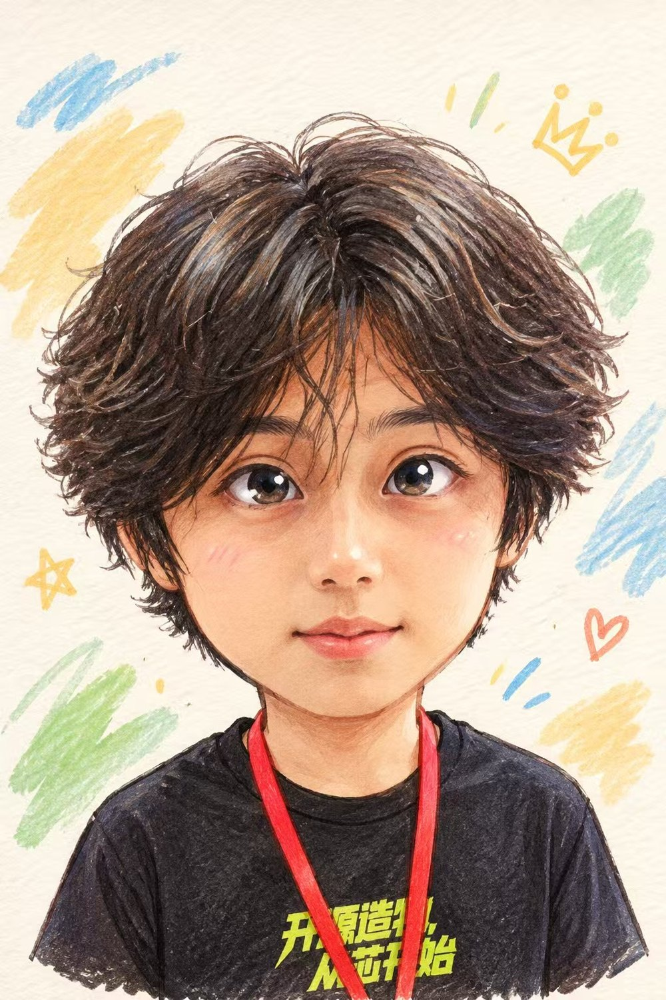
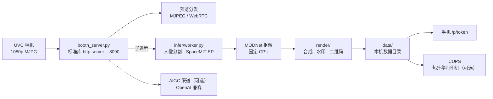

<div align="center">

# 赛博开发者证件照

**Cyber Developer ID Card — SpacemiT DevCon 2026 · 装置 5**

拍一张照片，K3 现场把它画成一张证件照：人像抠出来、风格画进去、编号盖上去，扫码带走。

[](LICENSE)
[](#快速开始)
[](#真机部署)
[](#隐私与合规)
[](#隐私与合规)



<sub>示例成片 · 晴空手绘风格 · 画面人物为 AIGC 合成素材，不含真实参会者</sub>

</div>

---

这个装置要证明的不是「能拍照」，而是**算力被看见**：大屏上人像掩码逐像素成形，
成片旁标注真实推理耗时与 `EP SpaceMIT` 徽章——这张照片是这块芯片自己算出来的。

全流程本机完成。不做人脸识别，不上传云端，照片默认 24 小时后自动清理。

## 目录

- [现场形态](#现场形态)
- [技术架构](#技术架构)
- [工程亮点](#工程亮点)
- [快速开始](#快速开始)
- [真机部署](#真机部署)
- [模型与素材](#模型与素材)
- [配置](#配置)
- [测试](#测试)
- [隐私与合规](#隐私与合规)
- [已知限制](#已知限制)
- [贡献](#贡献)
- [许可](#许可)

## 现场形态

同一个服务（默认端口 **8090**）提供四个界面：

| 路径 | 页面 | 使用者 | 作用 |
|---|---|---|---|
| `/` | 拍摄位 | 参会者 + 值守同事 | 实时取景、选风格、填署名、勾选拍摄告知、按快门、看成片与二维码 |
| `/stage` | 算力视图（大屏） | 围观者 | 实时预览、人像掩码成形过程、真实推理耗时、EP / CPU 徽章、最近成片 |
| `/operator` | 现场管理 | 值守同事 | 运行状态、排队、成片、风格、系统维护 |
| `/p/<token>` | 取图页 | 参会者手机 | 大图、保存、复制分享文案、删除我的照片 |

管理后台另有 `/operator/queue`、`/operator/photos`、`/operator/styles`、
`/operator/settings`、`/operator/system` 五个独立页面。

## 技术架构



| 模块 | 职责 |
|---|---|
| `booth_server.py` | 控制面。纯标准库 `http.server`，零 Web 框架、零 pip 依赖 |
| `camera.py` | UVC 抓帧 + 预览分发 + 掉线自愈。**唯一 import `cv2` 的地方** |
| `infer_client.py` / `infer/worker.py` | 推理子进程。**唯一碰 `onnxruntime` / `spacemit_ort` 的地方** |
| `gesture/worker.py` | 手势识别（OK 手势触发自动拍摄，可选） |
| `render/` | 成片合成：keyvisual / stylize / card / watermark / qr / print |
| `store.py` | 编号发号器 + 记录落盘 + 留存删除 |
| `auto_flow/` | 排队 / 同意 / 倒计时 / 自动拍摄（可选子系统） |
| `print_adapter.py` | CUPS 打印端口（默认关闭） |

## 工程亮点

这些都是上线后拿真机反馈换来的，不是设计时的假设：

<details>
<summary><b>推理必须另起进程</b></summary>

`cv2` 与 `spacemit_ort` 在同一个进程里会直接崩，不是报错、不是变慢，是段错误退出。
所以抓帧与推理拆成两个进程，跨进程传帧用共享内存 + 紧凑协议。
另外 `onnxruntime` 必须先于 `spacemit_ort` 导入，顺序反了一样崩。

</details>

<details>
<summary><b>MODNet 抠像固定走 CPU</b></summary>

把人像抠像模型挂到 AI 核上是进程硬崩。所以分割走 AI 核（空间大、收益高），
抠像固定 CPU（512 边长约 1.3 秒，够用）。这条不是调优结论，是崩溃边界。

</details>

<details>
<summary><b>不假装成功</b></summary>

没有相机就显式打 `MOCK` 黄标，没有 AI 核就如实降级并把徽章标成 `CPU`，
推理超时进 L0 降级并在成片上留标记。
测试里的 `SKIP` 是"环境缺失"，**不等于通过**——这条纪律写进了所有测试的输出约定。

</details>

<details>
<summary><b>取图入口是令牌，不是编号</b></summary>

编号 `SM-2026-0001` 是连号的，可枚举。把它当入口等于把全场照片变成批量下载器。
所以每张照片另发一个 22 位随机令牌（128 bit），二维码里只编令牌。

</details>

<details>
<summary><b>同模型多渠道竞速</b></summary>

AIGC 风格化接的是外部图像接口，单渠道超时是常态。做法是把同一个模型的多个渠道
（不同中转/账号）同时并发请求，**第一个拿到图的赢**，其余取消；失败渠道进冷却，
后台探活再放回来。面板上能看到哪条渠道、多少毫秒赢的。

</details>

<details>
<summary><b>相机掉线自己爬起来</b></summary>

USB 重新枚举后，进程手里的旧文件描述符变成 `deleted`，`read()` 恒返回 False，
重试多少次都没用。所以连续 3 次读空帧就触发重开：关掉 → 按 `by-id` 重新解析 → 重开，带冷却防抖。

</details>

## 快速开始

服务是纯标准库实现，不需要安装 Web 框架；只有推理、图像处理和相机需要额外依赖。

```bash
cd app
python3 booth_server.py --port 8090 --mock-camera
```

打开：

- 拍摄位 <http://127.0.0.1:8090/>
- 大屏 <http://127.0.0.1:8090/stage>
- 操作员 <http://127.0.0.1:8090/operator>
- 取图 <http://127.0.0.1:8090/p/&lt;取图令牌&gt;>

没有相机时用 `--mock-camera`，界面会显示 MOCK 标记，不会冒充真相机。

| 依赖 | 说明 |
|---|---|
| Python 3.10+ | K3 上使用系统 `/usr/bin/python3` |
| `Pillow` `numpy` | 成片合成必需 |
| `opencv-python` | 只有抓帧需要；K3 镜像通常已预装 |
| `onnxruntime` / `spacemit_ort` | 推理需要；K3 上使用系统自带版本 |
| Node.js | 只有前端测试脚本需要 |

## 真机部署

```bash
# 1) 安装依赖（Bianbu 系统通常已预装 cv2 / onnxruntime / spacemit_ort）
python3 -m pip install -r requirements.txt

# 2) 放置模型（不随仓库分发，见下节）
#    默认路径：/opt/devcon/assets/models/

# 3) 部署文件并安装服务单元
bash app/tools/deploy.sh --ssh root@<K3-IP> --source ./app --install-unit

# 4) 重启并自检
ssh root@<K3-IP> "systemctl restart devcon-booth"
curl -s http://<K3-IP>:8090/api/health
```

完整步骤、systemd 单元、大屏 kiosk、介质与权限见 [`app/deploy/README.md`](app/deploy/README.md)，
开场前逐项检查见 [`app/deploy/展前检查单.md`](app/deploy/展前检查单.md)，
现场排障见 [`app/docs/现场故障处置.md`](app/docs/现场故障处置.md)。

## 模型与素材

模型因体积与分发约定不随仓库提供，放到 `app/assets/models/` 或 `/opt/devcon/assets/models/`
（路径可用环境变量覆盖）：

| 用途 | 默认路径 | 环境变量 | 备注 |
|---|---|---|---|
| 人像分割 | `/opt/devcon/assets/models/yoloe-v8s-seg.dynq.onnx` | `BOOTH_SEG_MODEL` | SpaceMIT EP |
| 文本编码 | `/opt/devcon/assets/models/mobileclip.q.onnx` | `BOOTH_CLIP_MODEL` | 固定 CPU |
| 人形检测 | `/usr/share/yolo-demo/yolov8/yolov8n.q.onnx` | `BOOTH_DET_MODEL` | 取景辅助 |
| 人像抠像 | `/opt/devcon/assets/models/modnet.onnx` | `BOOTH_MATTE_MODEL` | 固定 CPU |

模型可从 SpacemiT 模型动物园获取（`https://archive.spacemit.com/spacemit-ai/model_zoo/vision/`）。

### 可选：AIGC 风格化渠道

风格化能力需要外接一个 OpenAI 兼容的图像接口，**本仓库不带任何渠道地址与密钥**：

- 代码里的默认地址是占位值 `https://api.example.com/v1`，模型预设是三条示例；
- 部署时用 `BOOTH_AIGC_BASE_URL` 指定默认地址，或在操作员面板「模型渠道」里逐个填；
- 密钥只存本机数据目录，接口只回 `key_configured: true`，不回显原文；
- 不接渠道时功能默认关闭（`BOOTH_AIGC_ENABLED=false`），拍摄与出图不受影响。

## 配置

所有配置都是环境变量，默认值经过现场验证。完整清单与参数边界见 [`app/README.md`](app/README.md)。

<details>
<summary><b>最常改的几个</b></summary>

| 变量 | 默认 | 作用 |
|---|---|---|
| `BOOTH_PORT` | `8090` | 监听端口 |
| `BOOTH_HOST` | `0.0.0.0` | 监听地址 |
| `BOOTH_DATA` | `<app>/data` | 数据目录 |
| `BOOTH_PHOTO_SIZE` | `1920x1080` | 拍照分辨率（再高会顶穿 USB2 带宽） |
| `BOOTH_PREVIEW_STREAM_SIZE` | `1280x720` | 浏览器收到的预览尺寸 |
| `BOOTH_PUBLIC_HOST` | 空 | 覆盖二维码里的主机名（默认自动探测局域网 IP） |
| `BOOTH_CONSENT_TTL` | `600` | 单次同意令牌有效期（秒） |
| `BOOTH_ACCESS_LOG` | `0` | 是否记录访问日志（默认不记 IP） |
| `BOOTH_PRINT_ENABLED` | `false` | 打印机装配开关（验收通过再开） |

</details>

数据目录长这样：

```text
app/data/
├── style-catalog.json        风格目录（随仓库发布的出厂数据）
├── background-catalog.json   底板目录（随仓库发布的出厂数据）
├── counter.json              编号发号器
├── photos/                   成片
├── thumbs/                   缩略图
├── captures/                 原片
├── masks/                    人像掩码
├── qr/                       取图二维码
└── records.jsonl             每次出图一条记录（删除会追加 tombstone）
```

## 测试

测试不依赖 pytest，用标准库断言，**退出码非 0 表示 FAIL**。输出里的 `SKIP`
表示如实降级（没相机、没 AI 核、没模型），**不是通过**。

```bash
cd app

python3 tests/test_qr.py            # 二维码编码/解码回环
python3 tests/test_subject_rules.py # 主体选取规则（坏值不崩）

# 以 app 包方式导入的测试，需要把仓库根也加进 sys.path
PYTHONPATH=".:.." python3 tests/test_store_retention.py
PYTHONPATH=".:.." python3 tests/test_server.py   # 全部路由 + 同意门禁 + 删除链路

python3 tests/test_camera.py        # UVC 抓帧（无相机时如实 SKIP）
python3 tests/test_worker.py        # 推理 worker（需要 onnxruntime 与模型）
node   tests/test_preview_client.js # 前端取景流守护（需要 node）
```

彩排脚本 `app/tests/e2e_test.py --n 20 [--mock]` 会跑一遍完整流程并输出成绩单。
全部测试的语境与判据见 [`app/tests/README.md`](app/tests/README.md)。

## 隐私与合规

| 原则 | 落地方式 |
|---|---|
| **不做人脸识别** | 只做人像/前景分割，不提取人脸特征、不做身份比对、不建人脸库 |
| **数据不出机** | 照片、掩码、成片全部写在本机数据目录；只有取图页在局域网内提供下载 |
| **默认 24 小时保留** | `retention_hours=24`，过期照片与派生文件由清理任务删除，取图链接同时失效 |
| **取图令牌** | 每张照片一个 22 位随机串（128 bit），与连号编号解耦 |
| **同意门禁** | 拍摄前必须勾选《拍摄告知》，同意令牌有时效，服务端强制校验 |
| **访问日志默认关闭** | 不记录 IP |

正式对外使用前请按当地法规完成法务审核。

## 已知限制

- **AI 核是共享资源**：同一块板上的其他推理服务会抢占，此时自动降级到 CPU 并如实标注。
- **K3 真机测试未在 CI 覆盖**：`test_worker.py`、`test_camera.py`、`e2e_test.py` 需要真机。
- **打印链路默认关闭**：CUPS 队列与首张样片验收通过后才建议开启。
- **手势子系统需要额外依赖**：cv2 + MediaPipe，未在仓库内附带模型。
- **AIGC 风格化依赖外部渠道**：延迟由渠道决定，本仓库只负责并发与失败退避。

## 贡献

见 [`CONTRIBUTING.md`](CONTRIBUTING.md)。开发约定里最要紧的两条：

- 控制面保持纯标准库，不引入 Web 框架；
- `cv2` 只出现在 `camera.py`，`onnxruntime` / `spacemit_ort` 只出现在推理 worker。

## 许可

代码以 **Apache-2.0** 发布，见 [`LICENSE`](LICENSE)。
第三方素材、字体与商标的边界见 [`NOTICE`](NOTICE)：Noto Sans CJK 为 SIL OFL 1.1，
SpacemiT 名称与主视觉归 SpacemiT，仅用于本项目现场装置语境。

---

<div align="center">
<sub>装置设计、现场流程与运维知识来自 SpacemiT DevCon 2026 装置 5 的实际落地过程 · <code>#SpacemiTDevCon</code></sub>
</div>
